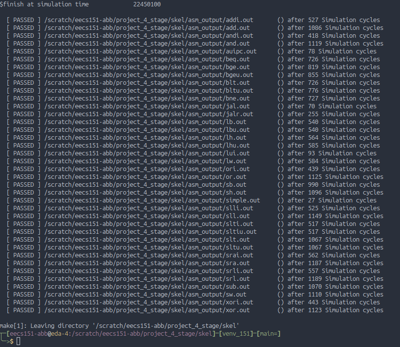
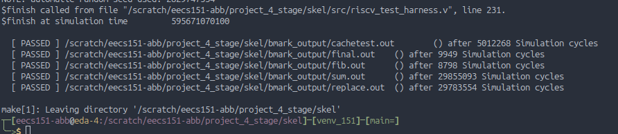
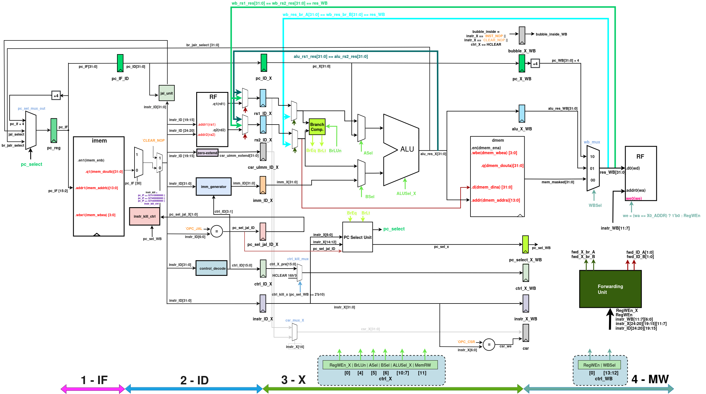
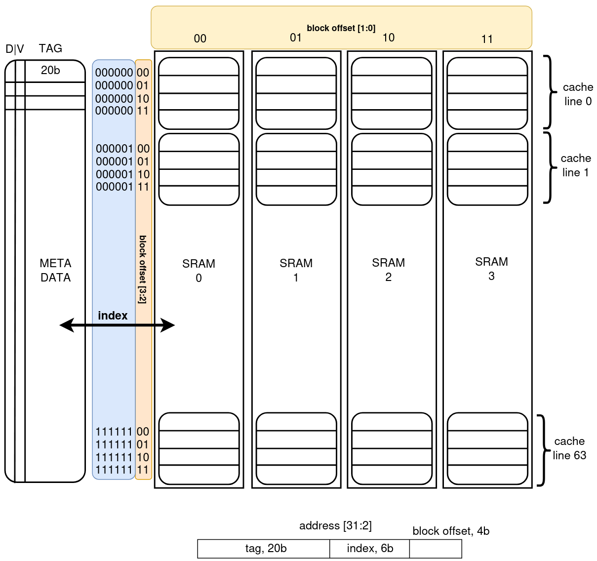
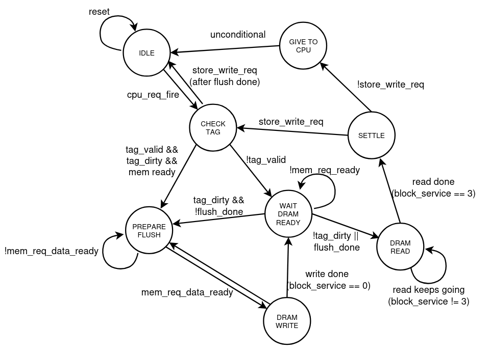
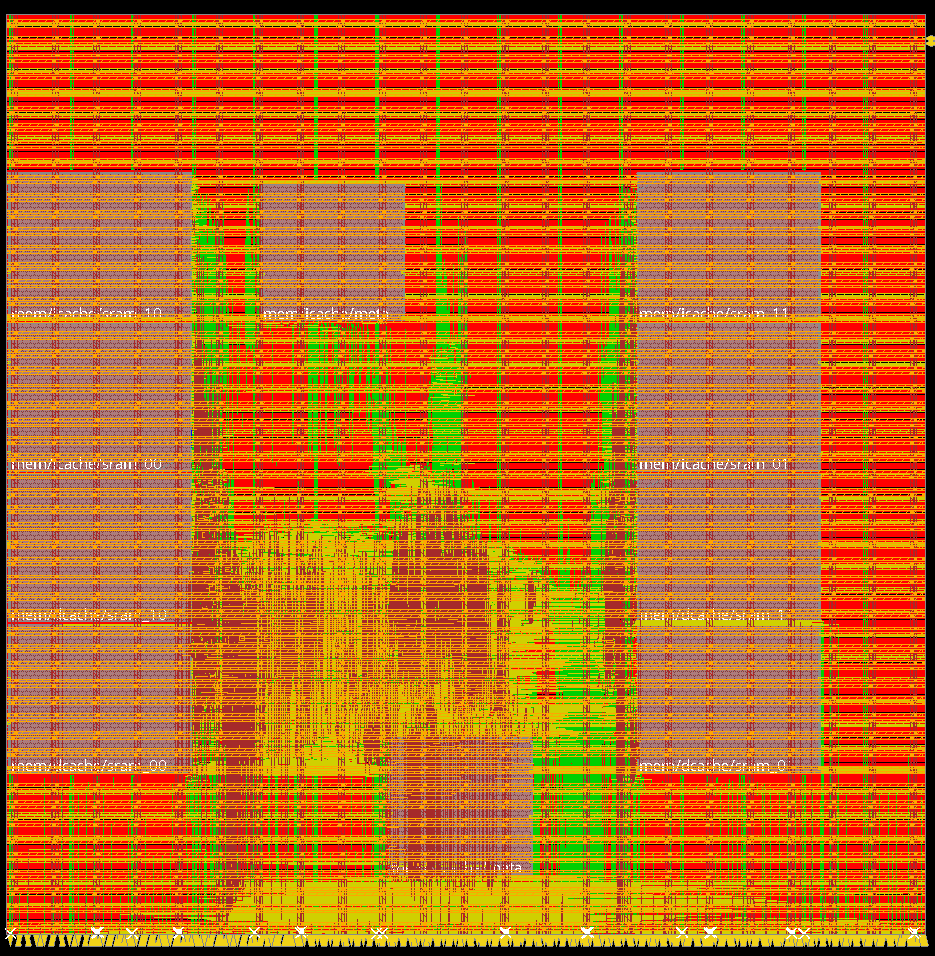

# RISC-V (rv32i) 4-stage pipelined ASIC design

A complehhate RV32I processor in Verilog (IEEE 1995/2001 syntax) as part of the EECS 151/251A ASIC project.

- **4-stage pipeline:** IF, ID, EX, and MEM/WB
- **Fully bypassed**
- **4 KiB direct-mapped cache** with dirty-line writeback
- **Cache controller** with DRAM refill and writeback support
- Passed all assembly and benchmark simulations
- Post-synthesis frequency: **125 MHz**
- Post-PnR timing closure at **55.56 MHz (18 ns)**
    - in the real world, a **0.055 ns** slack would be considered failure, of course.
- Critical path:
    - MEM/WB forwarding through the ALU into DCache control logic
- Post-layout area:
    - CPU core: **72,203 µm²**
    - SRAMs: **1.0178 mm²** (the hands-on experience of the textbook tenet "floorplan is dominated by memories")
    - Top: **1.09 mm²**
- Optimizations:
    - full bypassing
    - early JAL target handling

 

    <strong>Simulation results</strong>

 

## Cache Design

The processor includes a **4 KiB direct-mapped data cache** organized as 64 cache lines, each holding 16 words.
The data array is implemented using four 1 KiB SRAM banks, while a separate metadata array stores each line's tag,
valid bit, and dirty bit. Addresses are divided as 20/6/4 (Tag/Index/Offset) bits.

    

The cache controller (see FSM below) handles tag checks, hits and misses, DRAM line refills, and dirty-line WBs.
Requests stall the pipeline if cache service is required whereas write-back policy reduces traffic to the DRAM (model).

    

See [`assets/151A_Project_Report.pdf`](assets/151A_Project_Report.pdf) for the full design report.

## Floorplan

Large SRAM blocks around the sides and datapath + control logic (along with the cache controller logic)
in the middle.

    

